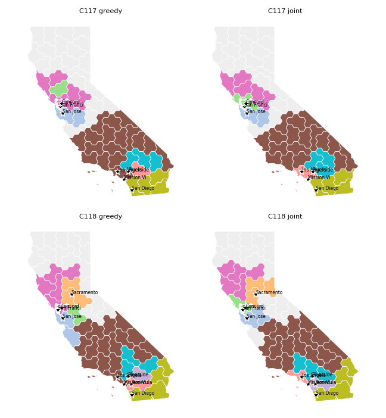
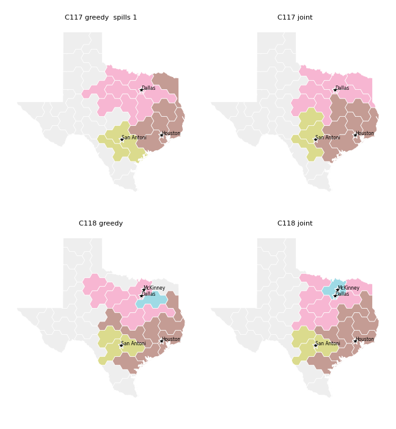
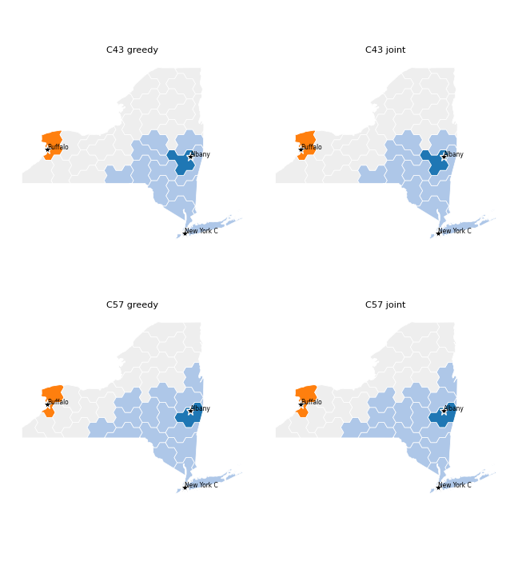

# Metro labels: joint assignment instead of greedy round-robin

Follow-up to [audit_tiling_quality.md](audit_tiling_quality.md) ("San Francisco: C117 vs
C118"). `label_urban_tiles` in `scripts/urban_clusters.py` decides which of a state's final
tiles carry each metro label. It used to grow clusters greedily, one tile per round,
largest cluster first. That was deterministic but order-dependent: the direction a crowded
cluster grew depended on which neighbour claimed a tile first. The Bay Area is the clearest
case: its metros need about 8–11 seats in a region of about 4 tiles.

## The new labeller

Labels only; the tile geometry is never touched. Three steps:

0. **Metro seeds.** Each national metro (`UrbanCluster.metro`, e.g. SF–Oakland + San Jose +
   Concord), largest first, takes the free tile nearest its principal area's anchor. Tiles
   in that anchor's Voronoi cell are preferred.
1. **Metro footprints.** All remaining seats are placed in one min-cost assignment of tiles
   to metros: one row per seat, solved by a pure-Python Hungarian algorithm (no scipy
   dependency). The cost is the **squared** distance to the metro's seat-weighted anchor
   centroid. Unassigned tiles stay rural. With squared distance, the optimum is a
   capacitated (power-diagram) Voronoi partition: compact blobs that meet along roughly
   straight lines, placed by seat counts rather than by growth order.
2. **Split inside each metro.** Each metro's footprint is divided among its own areas, with
   cost = squared distance ÷ seats. Satellites (San Jose, McKinney, Temecula) stay round on
   their own city, and the principal area takes the rest.

Then comes a **contiguity repair.** A piece that is cut off from the cluster's seed (or
from its largest piece) is released. The cluster then regrows by nearest-first BFS over
rendered-tile adjacency. Spill-over and the detached last resort are unchanged, so state
metro totals stay exact. `rank` is now the order by distance from the anchor.

### Variants that were measured and rejected

| Variant | Problem |
|---|---|
| One-level assignment (all areas compete, plain d²) | Satellites were pushed to the far side of the state: C118 Temecula landed on the Arizona line and McKinney in the NE corner. More clusters ended up off their own city (seeds > 2R: 995 vs 916). |
| Two-level with no seeds | Gave the best California stability (C117→C118 SF-metro IoU 0.77), but a big metro took a small one's city tile. In C33–C57 New York (≈15 seats, anchor at the state's tip) took Albany's tile, which moved Albany north up the Hudson. |
| Seeds per *area* (instead of per metro) | Fixes Albany. But SF, San Jose and Concord anchors sit within about one tile of each other, so their seeds flip on tiny input changes. CA jitter sensitivity got worse (centroid shift p95 4.5R). |
| Weighted cost at level 1 (d²/seats, or "distance beyond natural radius") | No better on any metric. d²/seats spilled more seats. |

## A/B results

Method: I ran the tiler (`--congresses …`, outputs to a scratch dir) with a hook that saved
every `label_urban_tiles` input. Then I ran the committed greedy labeller and the new one
on identical tiles and anchors. Distances are in R (hex circumradius; one pentahex is
≈ 2R across). "Spread" = mean distance of a cluster's tiles from its own centroid,
÷ √tiles. "Anchor-off" = distance from a cluster's centroid to its anchor.

### CA / TX / NY, C113–C119, default (1.0×) tier

| | CA greedy | CA joint | TX greedy | TX joint | NY (both) |
|---|---|---|---|---|---|
| mean tile→anchor | 6.87R | 6.99R | 4.29R | **4.00R** | 11.79R |
| max tile→anchor | 14.97R | 14.97R | 10.67R | **7.87R** | 17.65R |
| spread | 1.476 | **1.382** | 1.432 | **1.410** | 1.466 |
| anchor-off (mean / max) | 4.43 / 7.8R | **3.56** / 8.1R | 2.29 / 3.5R | **1.55 / 2.2R** | 10.8R |
| spilled seats | 0 | 0 | 5 | **0** | 0 |
| C117→C118 IoU (metro) | LA .80 · SF .45 · SD .58 | LA .80 · SF .46 · SD .58 | DFW .60 · Hou .48 · SA .49 | DFW **.69** · Hou **.62** · SA .36 | NYC .87 |

NY is a single cluster from C113 to C119, so both labellers give the same result. IoU is
the overlap of a metro's labelled area across the C117→C118 change (2020 census and new
tiles). See the figures below.

In California the joint labeller keeps the same picture across the census change. SF holds
the north coast, San Jose sits south of the Bay, Concord stays on its anchor, and LA stays a
compact SoCal blob. In greedy C118, San Jose runs down the coast and Concord sits out east
of the Bay. LA still reaches into the southern San Joaquin Valley under both labellers, because
SoCal holds only about 25 of CA's 52 tiles. That is set by the area-proportional outline,
not by the labeller.

In Texas, greedy C118 sends Houston (orange) along a strip west of San Antonio. With the
joint labeller Houston and Dallas stay compact, and McKinney sits on its own city.

### All states, C1–C119 (default tier; 11,221 labeller calls across all tiers)

| | greedy | joint |
|---|---|---|
| max tile→anchor | 31.4R | **24.4R** |
| p90 tile→anchor | 14.25R | 14.15R |
| spread | 1.382 | 1.364 |
| anchor-off mean (max) | 2.72R (16.9) | 2.65R (16.4) |
| spill events (seats) | 20 (25) | **10 (10)** |
| exact metro totals, every tier | yes | yes |

**Stability across real transitions.** I measured each consecutive Congress pair whose
inputs differ, keeping only states with two or more clusters. Each state was normalised to
centroid 0 and unit area, so state motion in the layout doesn't count.

| | greedy | joint |
|---|---|---|
| metro-level IoU mean / p10 / # < 0.25 (n = 206) | 0.598 / 0.251 / 20 | **0.608 / 0.276 / 16** |
| area-level IoU mean / p10 (n = 255) | 0.565 / 0.197 | 0.561 / 0.202 |
| CA+TX+NY area-level IoU mean (n = 101) | 0.579 | **0.590** |
| CA+TX+NY cluster-centroid shift max (state widths) | 0.364 | **0.237** |

**Sensitivity to jitter.** I added 0.25R Gaussian noise to anchors and tile centres, 20
trials per state, C117–C119:

| | greedy | joint |
|---|---|---|
| CA urban tiles relabelled / centroid shift p95 / max | 9.5% / 3.5R / 8.2R | 12.9% / **3.0R** / 12.8R |
| TX | 11.6% / 2.3R / 4.6R | **7.1%** / 2.5R / 4.8R |
| NY | 3.9% / 0.8R / 0.9R | same |

## Verdict

- **Better geography.** Clusters sit closer to their anchors and are more compact. The
  worst tile→anchor distance drops from 31R to 24R and spills are halved. Satellites stay on
  their own city, and no cluster's shape depends on growth order. Texas improves the most.
- **Stability: only a small improvement, not a fix.** Measured across every real
  Congress-to-Congress change, most label movement comes from the inputs, not the labeller:
  re-partitioned tiles (a tile is 1/N of a state, so moving one boundary tile changes a
  small cluster's IoU a lot), new census anchors, and changed seat counts. The joint
  labeller improves the tail (fewer near-zero IoUs, smaller worst centroid jumps). Under
  random jitter it relabels *more* boundary tiles in California, because the SF/SJ/Concord
  anchors are almost coincident and their capacitated-Voronoi boundary has near-ties.
- **If more stability is wanted later, it has to come from the inputs.** Two options:
  1. Make each metro's footprint a function of the scaled outline alone (a continuous
     power diagram in normalised outline space), then pick tiles by overlap. That would
     remove the dependence on the tile partition.
  2. Carry the previous Congress's labels as a tie-breaking prior (a small cost bonus for
     keeping a tile's label). This conflicts with the stateless design of the reference
     layout.

The committed `data_processed/` outputs were not regenerated on this branch. A full
pipeline run picks up the new labels.
